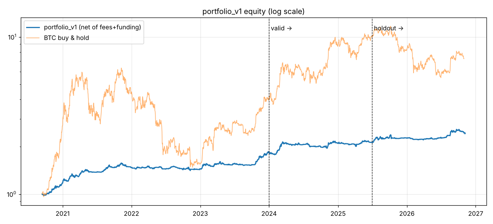

# REPORT — autoresearch round 1 (2026-11-07)

## Result: portfolio_v1 is profitable on train, valid AND holdout (after fees + funding)

| split | period | return | CAGR | Sharpe | max DD |
|---|---|---|---|---|---|
| train | 2020-09 → 2023-12 | +83.7% | +20.3% | 1.90 | -10.5% |
| valid | 2024-01 → 2025-06 | +16.4% | +10.7% | 1.05 | -8.9% |
| **holdout** (opened once) | 2025-07 → 2026-10 | **+13.9%** | **+10.1%** | **1.05** | **-7.1%** |
| holdout @ 2× costs | same | +12.2% | +8.9% | 0.93 | -7.5% |

Comparison: in the holdout, BTC buy & hold returned -32% (DD -54%) and ETH -13% (DD -70%).
Calendar years: 2020 (from Sep) +17.3%, 2021 +25.5%, 2022 -1.7%, 2023 +26.9%, 2024 +14.5%, 2025 +7.9%, 2026 YTD +7.4%.

## What is in it (`strategies/portfolio_v1.json`)
| sleeve | weight | rule | evidence |
|---|---|---|---|
| BTC/ETH/SOL/BNB trend | 15/15/10/10% | Binance USDT-M perps, long/flat. Average of sign(return) over 7/14/30/60/90/180 days, vol-targeted to 40%/yr, rebalanced daily | Time-series momentum (Moskowitz–Ooi–Pedersen 2012; crypto TSMOM literature) |
| QQQ IBS | 25% | Daily candle: if (close−low)/(high−low) < 0.2, hold QQQ the next day | Internal Bar Strength mean reversion (Pagonidis 2013, Quantpedia) |
| QQQ turn-of-month | 25% | Hold the last 2 trading days + first 3 trading days of each month | Ariel 1987, Lakonishok & Smidt 1988 |

All 6 sleeves were positive in the holdout.

## What failed (logged in `experiments.jsonl`, ~100 configs)
- ICT-style rules on crypto 1h: previous-day high/low sweep, Asia-range breakout/fade. Mostly negative after 6 bps fees.
- BTC 22–23h UTC seasonality: strongly negative after fees.
- Single-lookback TSMOM and Donchian: positive in train, broke in valid (overfit to one parameter).
- LightGBM walk-forward direction models: around Sharpe 0 to 0.7, unstable across coins. Not kept.
- Gold/silver/oil trend: weak in valid (2015–2021).

## Honest caveats
- Returns are modest by design (crypto sleeves use small weights, about 50% gross exposure). This is
  a low-drawdown edge, not a get-rich engine. Leverage scales both return and DD.
- About 100 configs were tried. The holdout was opened once for the strategy portfolio (plus 3 buy & hold baselines).
  Some selection bias remains (e.g. IBS without trend filter was chosen after seeing valid).
- QQQ fills assume trades at the close. Real execution needs MOC orders. Crypto assumes taker fills at the hourly close.
- Funding is included for perps. Borrow, tax and FX are not.
- Past performance ≠ future results. Paper-trade before any real money.

## Next rounds (for the loop)
1. Add gold (PAXG/XAUUSDT) and Nasdaq trend sleeves; test inverse-vol weights.
2. Use ML as a filter on top of the trend sleeve (not as a standalone predictor).
3. Paper-trading bot on Binance testnet for the crypto sleeve.

---

# Round 2 (2026-11-07): ML as a filter + regime + portfolio construction

**Verdict: nothing beat portfolio_v1 on train AND valid, so v1 stays the champion. No holdout look was spent on v2.**

| idea | where | result (valid Sharpe vs base) | verdict |
|---|---|---|---|
| Meta-labeling (LightGBM, walk-forward, purged) on crypto trend | BTC/ETH/SOL/BNB | BTC 1.35 vs 0.97, SOL 0.91 vs 0.45, **ETH -0.36 vs 0.79, BNB 0.03 vs 1.06** | REJECT (unstable across coins) |
| Meta-labeling, "scale" sizing | same | mixed, worse on ETH/BNB | REJECT |
| Meta-labeling on QQQ IBS / TOM | QQQ | IBS 1.01–1.05 vs 1.09, TOM 0.19–0.45 vs 0.52 | REJECT (no gain) |
| HMM regime filter (3 states, forward-filtered, walk-forward refit) | crypto | BTC/ETH ↑, SOL/BNB ↓ | REJECT |
| HMM regime filter (2 states) | crypto | ETH 1.58 ↑, others flat or ↓ | REJECT |
| HMM regime filter | QQQ IBS / TOM | 0.30 vs 1.09, -0.29 vs 0.52 | REJECT |
| Gold trend (PAXG 1h, GC=F daily) | gold | train Sharpe < 0 / 0.39 | REJECT |
| QQQ trend ensemble | QQQ | train 0.31 | REJECT |
| Inverse-vol sleeve weights (v2a) | portfolio | valid 0.63 vs 1.05 | REJECT |
| Inverse-vol + 10% vol target (v2b) | portfolio | valid 0.49 vs 1.05 | REJECT |

**Fees matter less for v1 than for intraday rules:** v1 with 0 fees: train Sharpe 2.01 / valid 1.17
(vs 1.90 / 1.05 with fees). v1 trades rarely, so fees cost only about 1–2%/yr. ICT intraday rules at 0 fees + 0 funding: train is negative
for 5 of 6 configs (2020–23); valid is mixed (BTC sweep Sharpe 1.38, SOL breakout -1.03). No consistent edge,
and with real fees (~400–560 trades per 18 months) any edge disappears.

**Lesson (same as the ML literature):** on daily/hourly OHLCV, gradient boosting and HMMs add little on
top of simple, well-documented effects. They fit the training period but do not generalise consistently.
Better ML inputs would need new data: order book, liquidations, open interest, on-chain, news sentiment.

Total configs logged: see `experiments.jsonl`. Holdout looks: unchanged (v1 only).

---

# Round 3 (2026-11-09): next-candle direction

**Verdict: DEAD as a strategy (holdout lost money at maker and taker cost). Keep only as a weak research indicator, not tradeable.**

Candidate frozen before the holdout look: `strategies/nextbar_btc_1h_lgbm_hold_m0.08_frozen_20261109.json`
(BTCUSDT perp 1h, walk-forward LightGBM, hold mode: flip only when |p-0.5| > 0.08).

| split | acc_conf | coverage | Sharpe taker 6bps | ret | max DD | Sharpe maker 2bps | ret | max DD | trades | BTC B&H Sharpe / ret / DD |
|---|---|---|---|---|---|---|---|---|---|---|
| train (2021-23) | 0.596 | 22% | 0.46 | +28% | -79% | 0.91 | +215% | -73% | 1124 | 0.77 / +223% / -79% (2020-23) |
| valid | 0.589 | 24% | 0.29 | +2.5% | -53% | 1.01 | +77% | -43% | 683 | 1.29 / +122% / -35% |
| **holdout** (2025-07 to 2026-10) | **0.552** | **16%** | **-1.19** | **-53.5%** | **-66%** | **-0.68** | **-38.3%** | **-59%** | 354 | -0.49 / -32% / -55% |

- Look-ahead review: none found. Features are truncation-invariant (25 random bars recomputed on data up to t: 0 mismatches).
  Label = sign(close[t+1]/close[t]); training rows < start use labels known by the close of `start`; engine: pos[t] earns close[t+1]/close[t];
  funding is floored to the hour and timestamped at the bar open, so it is known by the bar close. The accuracy metric compares p[t] with up[t]; no off-by-one.
- Minor (not a leak): `next_bar.py:143` drops bars where p is NaN or the next return is exactly 0 from the stats. In hold mode the
  position is still held on those bars, so their PnL and cost are left out (about 168 valid bars).
- Multiple testing: about 65 R3 configs, 210 lines in the log in total. The valid hit rate of 0.589 on about 3,150 bars (z ≈ 10) survives Bonferroni easily,
  so the direction signal is statistically real. Valid Sharpe does not pass: the bar is 0.5 + 0.1·log2(65) ≈ 1.10, against 0.29 at taker cost and 1.01 at maker cost.
  Holdout confirms it: the hit rate is still above chance (0.552, z = 4.6), but the edge is about 3–5 bps per confident bar,
  far below the costs, and wins are small while losses are large. The strategy lost more than buy and hold.
- Holdout looks: 2 (taker and maker), both on this one frozen version. Per the rules, this version is dead. Do not retune and re-run on this holdout window.
- Lesson: a hit rate is not PnL. Next-bar OHLCV direction has a small, decaying edge (accuracy 0.59 → 0.55, coverage 24% → 16%)
  that fees and the skew of returns wipe out. It could only be useful as a low-weight filter or input feature, and that would need a new holdout window.

## Round 3c (2026-11-09): predict the next H candles (`autoresearch/multi_bar.py`)
Walk-forward LightGBM, one decision every H bars, position held H bars, taker 6 bps + funding. 30 configs
(BTC/ETH 1h H=4/12/24, 4h H=3/6; margin 0/0.05/0.10). Train + valid only; holdout not opened.

| best configs | acc_conf train / valid | Sharpe train / valid |
|---|---|---|
| btc_1h H=4, margin 0.10 | 0.592 / 0.612 | 0.01 / 0.45 |
| btc_1h H=12, margin 0.10 | 0.540 / 0.570 | 0.19 / 0.60 |
| btc_1h H=24, margin 0.10 | 0.520 / 0.607 | 0.25 / 1.48 |

Verdict: **REJECT.** Losses are much smaller than with 1-bar trading, but no config is solid on train
(Sharpe ≤ 0.6). High valid Sharpe values with weak train are treated as luck. Accuracy is highest at H=4 (~60% on confident
calls, stable train→valid) but the move is still too small vs. fees. Next: use the H=4 signal as a
filter on the trend sleeve instead of trading it alone.

## Round 3d (2026-11-09): ML forecast as a veto on the crypto trend sleeves (`autoresearch/trend_filter.py`)
Trend ensemble picks exposure; walk-forward LightGBM P(up over next H bars) can only veto it (flat until the
next decision if P(up) < 0.5 − margin). 4 variants × 4 coins, train + valid, holdout not opened.
Sharpe train / valid (daily), portfolio max DD on valid:

| variant | BTC | ETH | SOL | BNB | portfolio | DD valid |
|---|---|---|---|---|---|---|
| v1 (no filter) | 1.50/0.95 | 0.93/0.84 | 1.79/0.49 | 1.17/1.08 | **1.90/1.04** | -9% |
| H=4, m=0 | 1.27/0.47 | 0.68/0.37 | 1.82/-0.13 | 1.29/0.39 | 1.85/0.47 | -7% |
| H=4, m=0.05 | 1.15/0.98 | 0.89/0.36 | 1.81/0.04 | 1.11/0.29 | 1.80/0.66 | -9% |
| H=24, m=0 | 1.85/1.19 | 1.09/0.55 | 1.69/1.15 | 0.80/0.50 | **2.07/1.03** | -6% |
| H=24, m=0.05 | 1.91/0.48 | 0.94/0.82 | 1.71/0.96 | 0.76/1.06 | 2.01/0.98 | -7% |

Verdict: **REJECT** under the program rule (portfolio valid Sharpe must beat v1: 1.03 vs 1.04). The H=4
filter (most accurate forecast) hurts. H=24 m=0 is the only interesting one: train Sharpe ↑, valid flat,
valid DD −9% → −6%, but per-coin effects are mixed (BTC ↑↑, BNB ↓↓), the same instability seen in round 2.
Not adopted; changing the objective to "lower DD" after seeing this would be data snooping.

## Round 4 (2026-11-09): open interest / long-short ratio features (`autoresearch/metrics_ml.py`)
New data: data.binance.vision daily `metrics` (5-min OI, top-trader and global long/short ratios, taker
buy/sell ratio), last stamp inside each 1h bar. Fair A/B on identical rows: A = price/volume/funding
features, B = A + 17 OI/long-short features. Metrics start 2020-09 (BTC) / 2021-12 (ETH, SOL, BNB), so with a
1-year warm-up only BTC has train-period forecasts; the comparison is mostly on valid.

Valid hit rate on all decisions, A → B:
| H | BTC | ETH | SOL | BNB |
|---|---|---|---|---|
| 4 bars | 0.549 → 0.544 | 0.542 → 0.536 | 0.527 → 0.512 | 0.526 → 0.521 |
| 24 bars | 0.535 → 0.558 | 0.524 → 0.524 | 0.508 → 0.522 | 0.516 → 0.512 |

Portfolio with an H=24 veto on the crypto trend sleeves (Sharpe train / valid, valid DD):
v1 1.90 / **1.04** (−8.9%) · veto A 1.98 / 0.69 (−7.6%) · veto B 1.93 / 0.79 (−5.3%).

Verdict: **REJECT.** OI/long-short features make the 4-bar forecast slightly worse on all 4 coins and are
mixed at 24 bars (+BTC, +SOL, =ETH, −BNB). The veto still lowers drawdown but costs valid Sharpe. v1 stays
the champion. Conclusion after rounds 3–4 (~150 configs): with free public Binance data, short-horizon
direction forecasts reach 54–60% hit rates on confident calls but do not beat costs or improve the trend
portfolio. Next research should target different edges (e.g. funding/basis carry, cross-sectional momentum
across many coins) rather than more next-candle models.

# Round 5 (2026-11-09): cross-section & carry (`autoresearch/xsec.py`, `autoresearch/portfolio_v2.py`)
28-coin daily Binance perp universe (`src/trading/data/universe.py`, **survivorship-biased**: coins still listed today).
Sleeves: cross-sectional momentum (xsmom), funding carry (fcarry), BTC/ETH cash-and-carry (cashcarry). 17 sleeve
configs + 3 portfolio variants tried on train/valid. Frozen before the holdout look:
`strategies/portfolio_v2b_frozen_20261109.json` = mean of [v1, xsmom_ls_L14 × 0.294, fcarry_ls_L7 × 0.285]
(scales = train-vol only).

## Look-ahead audit (risk-auditor): no leak found
- Signals use data ≤ t: `pct_change(L)` rank (xsec.py:64), history count `cumsum` (:63, :81), trailing funding
  `rolling(L).sum()` (:82). No `shift(-` in features; no centred windows; no full-sample normalisation.
- `weekly()` (:58) samples rows at t and forward-fills → stale-only, no future info.
- Returns: `ret = pct_change().shift(-1)` (:48) earns close[t]→close[t+1] with weight at t; `pnl.shift(1)` (:54)
  labels it by realisation day t+1. Daily klines are indexed by open time (loaders.py:88-91), close = that day's close.
- Funding: events floored to the day (universe.py:39), `fund.shift(-1)` (:52) charges day t+1's 00/08/16 UTC events
  to the weight set at close t — correct (the 00:00 t+1 settlement coincides with the rebalance instant; ambiguous by
  one settlement at most).
- v1 daily pnl (portfolio.py:37-38) is also labelled by the realisation day → aligned with xsec pnl.
- Scale (portfolio_v2.py:174) uses train rows only.
- Sanity: lagging weights 1-2 extra days does not collapse train/valid Sharpe (xsmom 1.31/1.21 → 0.88/1.55,
  fcarry 1.44/0.98 → 1.23/0.90): no leak signature.

## Realism issues (not charged / not modelled)
- **Drift turnover not charged**: weights are held constant between weekly rebalances (implicit daily rebalancing).
  Measured drift ≈ 3.7%/day → ~0.8%/yr per sleeve at full scale (~0.25%/yr at the 0.29 scale).
- **Sleeve mixing** `.mean(axis=1)` = daily rebalancing between v1 and the sleeves; that cost is not charged (small).
- **Survivorship**: for xsmom it removes delisted losers from the short leg (removes the coins that would have paid
  the short) — direction ambiguous, but it removes blow-up risk on the long leg → flattering. For fcarry, the
  dead coins (high funding into collapse) would mostly have helped the short leg; bias likely smaller.
- Rebalance phase matters a lot: shifting the weekly rebalance day 0-6 moves valid Sharpe 0.22-1.75 (xsmom)
  and 0.98-2.15 (fcarry). The chosen phase 0 is not cherry-picked, but the single number is noisy.
- Shorting alt perps: borrow is not needed, but alt perps have wider spreads than 6 bps, ADL / funding caps,
  and 4h funding intervals in stress; funding cache ends 2026-10-31 (last ~9 days of the holdout have 0 funding).
  BNBUSDT archive shows ~50% exactly-zero funding prints — possibly a data artefact.
- cashcarry needs a 5.7× scale (train vol tiny) → leverage, spot/perp margin and basis-blowout risk not modelled.

## Holdout (2025-07-01 → 2026-11-09), opened ONCE for v2b — Sharpe / CAGR / max DD
| | train | valid | holdout 1× cost | holdout 2× cost |
|---|---|---|---|---|
| v1 | 1.90 / 20.2% / −10.6% | 1.05 / 10.7% / −8.9% | 1.13 / 10.9% / −7.2% | 1.01 / 9.6% / −7.5% |
| **v2b (frozen)** | 2.61 / 16.5% / −4.6% | 1.84 / 8.1% / −2.9% | **1.43 / 6.0% / −3.1%** | **1.19 / 4.9% / −3.2%** |
| v2a (info only) | 5.14 / 30.7% / −4.8% | 3.74 / 13.7% / −2.1% | 1.16 / 3.6% / −2.3% | – |
| xsmom_ls_L14 alone | 1.50 / 57% / −27% | 1.21 / 29% / −17% | **−0.15 / −5.3% / −22%** | −0.32 / −8.6% / −23% |
| fcarry_ls_L7 alone | 1.26 / 47% / −38% | 0.98 / 17% / −14% | 1.50 / 29.6% / −16% | 1.34 / 25.9% / −17% |
| cashcarry_btceth_th10 alone | 6.19 / 13% / −3.3% | 5.49 / 5.1% / −0.7% | −1.52 / −0.6% / −0.9% | – |
| buy & hold BTC | 1.00 / 56% / −77% | 1.47 / 86% / −28% | −0.38 / −21.5% / −53% | |
| buy & hold EW 28 coins | 1.24 / 99% / −83% | 0.49 / 9.4% / −60% | −0.28 / −31.0% / −68% | |

Holdout looks this round: 1 opening of frozen v2b (`portfolio_v2.py --holdout` + one detail script for sleeves,
2× cost and buy & hold, logged in `experiments.jsonl`). Detail: `results/portfolio_v2b_holdout_detail.json`.

## Multiple testing
`experiments.jsonl` has 317 lines (≈ 300+ configs over 5 rounds). Hurdle 0.5 + 0.1·log2(317) ≈ **1.33**.
v2b valid 1.84 clears it; the sleeves alone do not (xsmom 1.21, fcarry 0.98). Round-5-only hurdle (N=20) ≈ 0.93.
v1 was already known to work on the holdout when it was chosen as a v2b sleeve → v1's part of the holdout is not fresh.

## Verdict
**v2b passes the holdout** (2× cost Sharpe 1.19 > 0.8, DD −3.2% < 20%) and beats v1 on Sharpe and DD — but the gain
comes from **fcarry only**; xsmom lost money on the holdout and cash-and-carry (the best valid sleeve) collapsed as
funding compressed. CAGR is only ~5-6% unlevered (sleeves are diluted to 1/3 each); levering it to v1's ~10%
doubles the uncharged costs and the tail risks above. Honest read: funding carry looks like a real, uncorrelated
edge; xsmom-L14 is not robust (phase- and period-sensitive). A follow-up "v1 + fcarry only" would be a NEW version
chosen after seeing this holdout → it must wait for fresh data (paper trade from 2026-11-10), not re-use this window.
